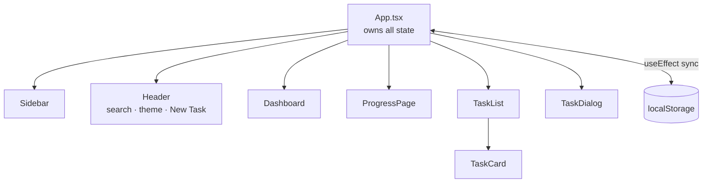

# 🛠️ Development Guide

**Contents:** [Architecture](#architecture) · [Reference](#file-by-file-reference) · [Styling](#styling) · [Animation](#animation) · [Extending](#common-extension-tasks) · [Performance](#performance) · [Debugging](#debugging) · [Build](#building-and-deploying) · [Testing](#testing)

---

## Architecture



### Data flow

1. `App.tsx` holds all state: `tasks`, `categories`, `filters`, `theme`, `view`, and dialog open/edit state.
2. State and handlers (`onAddTask`, `onToggleComplete`, …) are passed down as props. There is no context or external state library.
3. Handlers update state in `App.tsx`, which re-renders children and triggers the `localStorage` sync effects.

> **Scaling note:** once prop drilling gets painful (3+ levels), move task state into a `TasksContext` with `useReducer`. The handler names can stay the same, so child components barely change.

---

## File-by-file reference

### `src/app/types/index.ts`

| Type | Shape |
|---|---|
| `Task` | id, title, description, completed, priority, categoryId, dueDate, reminder, duration (minutes), subtasks, tags, createdAt / updatedAt / completedAt |
| `Subtask` | id, title, completed |
| `Category` | id, name, color |
| `Priority` | `'high' \| 'medium' \| 'low'` |
| `FilterState` | search, category, priority, status |
| `TaskStats` | the shape consumed by the Dashboard |

### `src/app/utils/storage.ts`
Thin `localStorage` wrappers, all wrapped in try/catch so full or unavailable storage doesn't crash the app:
- `getFromStorage<T>(key, defaultValue)`
- `saveToStorage<T>(key, value)`
- `removeFromStorage(key)`

### `src/app/utils/dateUtils.ts`
Helpers used by the Dashboard and task cards: `isToday`, `isOverdue`, `isThisWeek`, `formatDate`, `formatDateTime`, `formatTime`, plus relative-time formatting.

### `src/app/utils/taskUtils.ts`

| Function | Purpose |
|---|---|
| `calculateTaskStats(tasks, categories)` | Builds `TaskStats`: totals, overdue / due-today / due-this-week, breakdowns, completion rate |
| `filterTasks(tasks, filters)` | Search + category / priority / status filtering |
| `sortTasks(tasks)` | Completed last, then priority, then due date, then creation date |
| `getTaskCompletionPercentage(task)` | Subtask completion % for one task |

### `src/app/components/`

| Component | Responsibility |
|---|---|
| `Dashboard.tsx` | Stat cards, completion rate, priority / category breakdown |
| `ProgressPage.tsx` | Progress-over-time view |
| `Sidebar.tsx` | View switcher, quick filters (High Priority, Today), category list |
| `SearchBar.tsx` | Controlled search input |
| `TaskList.tsx` | Applies `filterTasks` / `sortTasks`, renders `TaskCard`s, owns drag-and-drop reordering |
| `TaskCard.tsx` | Checkbox, badges, subtask progress, drag handle, edit/delete menu |
| `TaskDialog.tsx` | Create/edit form (all task fields, subtasks, tags) |
| `ui/` | shadcn/ui primitives. Generally shouldn't need edits |

---

## Styling

Tailwind CSS v4 via the `@tailwindcss/vite` plugin (see `vite.config.js`), with no `tailwind.config.js`. Theme tokens and CSS variables live in `src/styles/`.

### Dark mode

Many components branch on the `theme` prop directly:

```tsx
className={theme === 'dark' ? 'bg-gray-800 text-white' : 'bg-white text-gray-900'}
```

This works, but it duplicates every colour decision in JS. The preferred approach is semantic tokens plus the `dark:` variant (enabled by `@custom-variant dark (&:where(.dark, .dark *));` in your theme CSS):

```tsx
// Before
className={theme === 'dark' ? 'bg-gray-800 text-white' : 'bg-white text-gray-900'}

// After: no theme prop needed
className="bg-card text-card-foreground"
```

Tokens like `bg-background`, `text-foreground`, `bg-card`, `border-border` and `text-muted-foreground` switch automatically when `.dark` is on `<html>`. Migrate component by component. Both styles can coexist.

### Responsive

Standard Tailwind breakpoints: `hidden sm:block`, `grid grid-cols-1 sm:grid-cols-2 lg:grid-cols-4`.

---

## Animation

`motion` (the current Framer Motion package), imported from `motion/react`:

```tsx
<motion.div initial={{ opacity: 0, y: 20 }} animate={{ opacity: 1, y: 0 }} transition={{ duration: 0.3 }} />
<AnimatePresence mode="wait">{condition && <motion.div exit={{ opacity: 0 }} />}</AnimatePresence>
<motion.div whileHover={{ scale: 1.05 }} />
```

**Respect reduced motion.** Wrap the app once and every `motion` component follows the OS setting:

```tsx
import { MotionConfig } from 'motion/react'

<MotionConfig reducedMotion="user">
  <App />
</MotionConfig>
```

**Spring feel:** use `transition={{ type: 'spring', stiffness: 400, damping: 22 }}` for toggles and buttons.

---

## Common extension tasks

### Add a field to `Task`
1. Add it to the `Task` interface in `types/index.ts`.
2. Add form state and a control in `TaskDialog.tsx`, and include it in the object passed to `onSave`.
3. Display it in `TaskCard.tsx`.
4. If saved data may lack it, handle `undefined` in `storage.ts` hydration (see [Data migrations](#data-migrations)).

### Add a filter
1. Add the field to `FilterState`.
2. Add the UI control (e.g. in `Sidebar.tsx`).
3. Add the condition in `filterTasks()`.

### Add a view
1. Extend the `view` union in `App.tsx` (currently `'dashboard' | 'tasks' | 'progress'`).
2. Create the component and render it in `App.tsx`.
3. Add navigation in `Sidebar.tsx`.

### Data migrations
Because data lives in users' browsers, changing the stored shape can break existing users. Version the storage key:

```ts
const STORAGE_VERSION = 2
const KEY = `tasks:v${STORAGE_VERSION}`

// on load: read old key, transform, write new key, remove old
```

---

## Performance

`filterTasks` / `sortTasks` run on every `TaskList` render. Memoize the derived list:

```tsx
const visibleTasks = useMemo(
  () => sortTasks(filterTasks(tasks, filters)),
  [tasks, filters]
)
```

Other cheap wins:
- Debounce the search input (about 200 ms) before it updates `filters`.
- Wrap `TaskCard` in `React.memo` and use `useCallback` for handlers, so toggling one task doesn't re-render all of them.
- Lazy-load the heavy views: `const ProgressPage = lazy(() => import('./components/ProgressPage'))` (Recharts is a big chunk).

---

## Debugging

| Symptom | Check |
|---|---|
| Tasks not saving | `localStorage` enabled and not full (soft 5–10 MB cap). Look for JSON errors from `storage.ts` |
| Drag-and-drop dead | The tree must still be wrapped in `<DndProvider backend={HTML5Backend}>` (set up once in `App.tsx`) |
| Theme not persisting | `localStorage.setItem('theme', …)` firing, and the `dark` class toggled on `document.documentElement` |
| `dark:` classes ignored | Missing `@custom-variant dark …` in the theme CSS |
| Type errors on build | Run `pnpm typecheck` to see them without bundling |

---

## Building and deploying

```bash
pnpm build        # type-check, then static bundle in dist/
pnpm preview      # smoke-test the production build locally
```

`dist/` is a static site that works on any static host (Vercel, Netlify, Cloudflare Pages, GitHub Pages, …) with no server. For GitHub Pages, set `base: '/<repo-name>/'` in `vite.config.js`.

---

## Testing

No tests are included yet. Suggested setup:

| Layer | Tool | Start with |
|---|---|---|
| Unit | **Vitest** | `taskUtils` and `dateUtils`. They're pure functions, so they're the best return on effort |
| Component | **React Testing Library** | `TaskDialog` validation, `TaskCard` toggle |
| End-to-end | **Playwright** | create → edit → complete → delete |

```bash
pnpm add -D vitest @testing-library/react @testing-library/jest-dom jsdom
```

Example first test:

```ts
import { describe, it, expect } from 'vitest'
import { sortTasks } from '../utils/taskUtils'

describe('sortTasks', () => {
  it('puts completed tasks last', () => {
    const sorted = sortTasks([
      { id: '1', completed: true, priority: 'high' },
      { id: '2', completed: false, priority: 'low' },
    ] as any)
    expect(sorted[0].id).toBe('2')
  })
})
```

---

## Further reading

[React](https://react.dev) · [TypeScript](https://www.typescriptlang.org/docs/) · [Tailwind](https://tailwindcss.com/docs) · [Motion](https://motion.dev) · [react-dnd](https://react-dnd.github.io/react-dnd/) · [shadcn/ui](https://ui.shadcn.com/) · [Vitest](https://vitest.dev)

See [CONTRIBUTING.md](./CONTRIBUTING.md) for PR and commit conventions.
