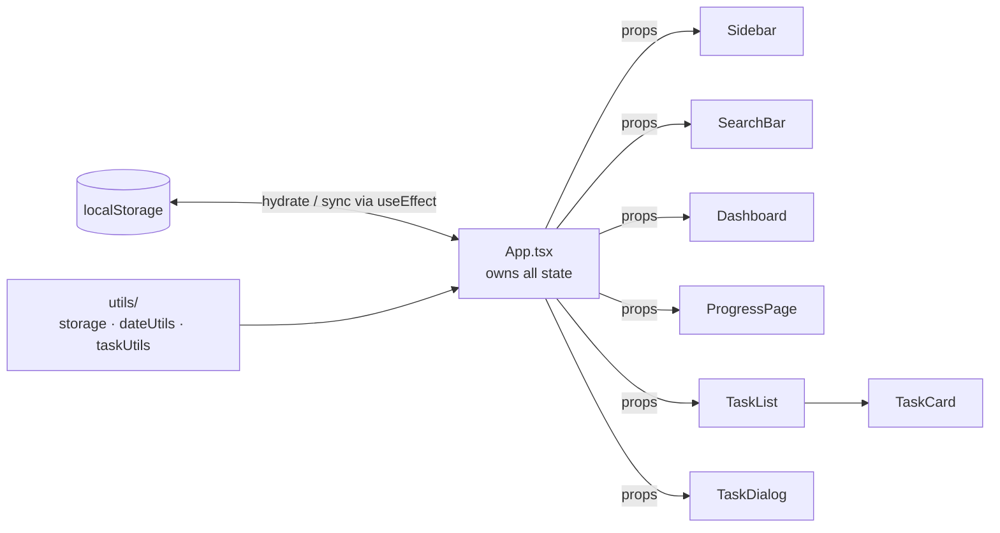

<div align="center">

# ✅ Advanced To-Do List App

**A feature-rich task manager with a stats dashboard, drag-and-drop, subtasks, tags, reminders and light/dark themes. Everything stays in your browser.**


[Features](#features) · [Quick start](#quick-start) · [Architecture](#architecture) · [Deploy](#deployment) · [Roadmap](#roadmap)

</div>

> Originally exported from [Figma Make](https://www.figma.com/design/NQhncxSK8QkTD3pSh0pPvY/Advanced-To-Do-List-App). This README describes the app as implemented in this codebase.

---

## Features

### Task management
- Create, edit and delete tasks with title, description, priority, category, due date, reminder, estimated duration, subtasks and tags
- Complete or reopen tasks and individual subtasks
- Reorder with drag-and-drop (`react-dnd`)

### Organization
- Four starter categories (Work, Personal, Communication Skills, Health), each with a colour
- High / Medium / Low priority
- Free-form tags
- Live search across title, description and tags
- Filter by category, priority and status

### Views
| View | What you get |
|---|---|
| **Dashboard** | Total / active / completed / overdue counts, due today and this week, completion rate, priority and category breakdown |
| **Tasks** | Full filterable, reorderable list |
| **Progress** | Completion tracking over time |

### UI/UX
- Light and dark themes, persisted, with animated transitions
- Responsive on mobile, tablet and desktop
- Micro-interactions via `motion`

### Data
- Tasks, categories and theme are stored in `localStorage`. There is no backend or account system, so data lives only in the browser where it was created.

---

## Tech stack

| Layer | Choice |
|---|---|
| Framework | React 18 + TypeScript |
| Build tool | Vite 6 |
| Styling | Tailwind CSS v4 |
| Components | shadcn/ui (Radix UI primitives) |
| Animation | Motion (Framer Motion) |
| Drag & drop | react-dnd (HTML5 backend) |
| Icons | lucide-react |
| Charts | Recharts |
| Persistence | Browser `localStorage` |

---

## Quick start

**Requirements:** Node.js **20.19+** (Vite 6) and [pnpm](https://pnpm.io) 10+ (npm also works).

```bash
pnpm install      # install dependencies
pnpm dev          # dev server with hot reload (http://localhost:5173)
pnpm build        # type-check + production bundle in dist/
pnpm preview      # serve the production build locally
```

| Script | What it does |
|---|---|
| `dev` | Start Vite's dev server |
| `build` | Run `tsc --noEmit`, then `vite build` |
| `typecheck` | Type-check only |
| `preview` | Preview the production build |
| `clean` | Remove `dist/` and Vite's cache |

See [QUICKSTART.md](./QUICKSTART.md) for a usage walkthrough.

---

## Architecture



All state (`tasks`, `categories`, `filters`, `theme`, `view`, dialog state) lives in `App.tsx` and flows down as props, with no external state library. `tasks`, `categories` and `theme` are written to `localStorage` on every change and rehydrated on load.

### Project structure

```
.
├── index.html                  # Vite entry HTML
├── src/
│   ├── main.tsx                # React entry point
│   ├── styles/                 # Global CSS, theme tokens, Tailwind config
│   └── app/
│       ├── App.tsx             # Root component, owns all app state
│       ├── types/index.ts      # Task, Category, Subtask, Filter, Stats types
│       ├── utils/
│       │   ├── storage.ts      # localStorage get/save/remove helpers
│       │   ├── dateUtils.ts    # Formatting & comparison (today/overdue/this week)
│       │   └── taskUtils.ts    # Filtering, sorting, stats
│       └── components/
│           ├── Dashboard.tsx
│           ├── ProgressPage.tsx
│           ├── Sidebar.tsx
│           ├── SearchBar.tsx
│           ├── TaskList.tsx    # Filtered/sorted list with drag-and-drop
│           ├── TaskCard.tsx
│           ├── TaskDialog.tsx  # Create/edit modal
│           └── ui/             # shadcn/ui primitives
├── guidelines/Guidelines.md
└── *.md                        # Docs (see index below)
```

---

## Deployment

`pnpm build` outputs a static bundle to `dist/`, which works on any static host.

| Host | Settings |
|---|---|
| **Vercel / Netlify / Cloudflare Pages** | Build command `pnpm build`, output directory `dist` |
| **GitHub Pages** | Set `base: '/<repo-name>/'` in `vite.config.js`, then publish `dist/` |

If you add client-side routing later, configure an SPA fallback (rewrite all paths to `index.html`).

---

## Troubleshooting

| Problem | Fix |
|---|---|
| `Cannot find module @rollup/rollup-…` or `@esbuild/…` | Native binary missing for your OS. Delete `node_modules` and the lockfile, then reinstall. Make sure `pnpm-workspace.yaml` includes `current` in `supportedArchitectures`. |
| `dark:` styles ignore the theme toggle | Tailwind v4 needs `@custom-variant dark (&:where(.dark, .dark *));` in your theme CSS. |
| Tasks vanished | `localStorage` was cleared, or you're in a different browser or profile. There is no server copy. |
| Node version error | Upgrade to Node 20.19 or newer. |

---

## Known limitations

- **Single browser, single device:** no sync, and data is lost if site data is cleared
- **No backend:** no accounts, collaboration or real-time sync
- **Storage ceiling:** `localStorage` is capped at roughly 5–10 MB per origin, which is plenty for typical task lists

---

## Roadmap

- [ ] Export / import tasks as JSON (backup and device transfer)
- [ ] Recurring tasks
- [ ] Browser notifications for reminders
- [ ] Keyboard shortcuts and a command palette (`cmdk` is already installed)
- [ ] Optional cloud sync
- [ ] Unit tests for `taskUtils` and `dateUtils` (Vitest)

See [CHANGELOG.md](./CHANGELOG.md) for version history and [BUGFIXES.md](./BUGFIXES.md) for fixed issues.

---

## Documentation index

| Doc | Covers |
|---|---|
| [QUICKSTART.md](./QUICKSTART.md) | 5-minute usage guide |
| [DEVELOPMENT_GUIDE.md](./DEVELOPMENT_GUIDE.md) | Architecture, file-by-file breakdown, extending the app |
| [CONTRIBUTING.md](./CONTRIBUTING.md) | How to propose changes |
| [CHANGELOG.md](./CHANGELOG.md) | Version history and roadmap |
| [BUGFIXES.md](./BUGFIXES.md) | Notable bugs found and fixed |
| [ATTRIBUTIONS.md](./ATTRIBUTIONS.md) | Third-party licenses and assets |

---

## License

No license file is included, so all rights are reserved by default. To open-source the project, add a `LICENSE` file (MIT is a common permissive choice).
